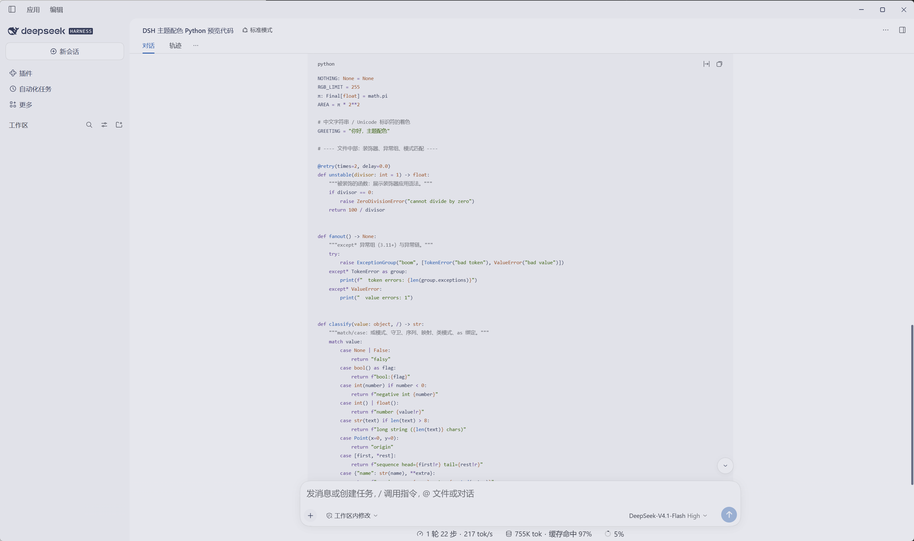
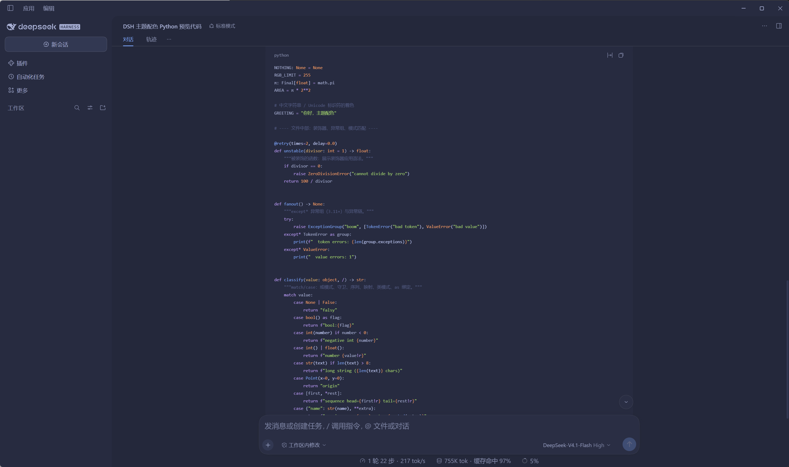
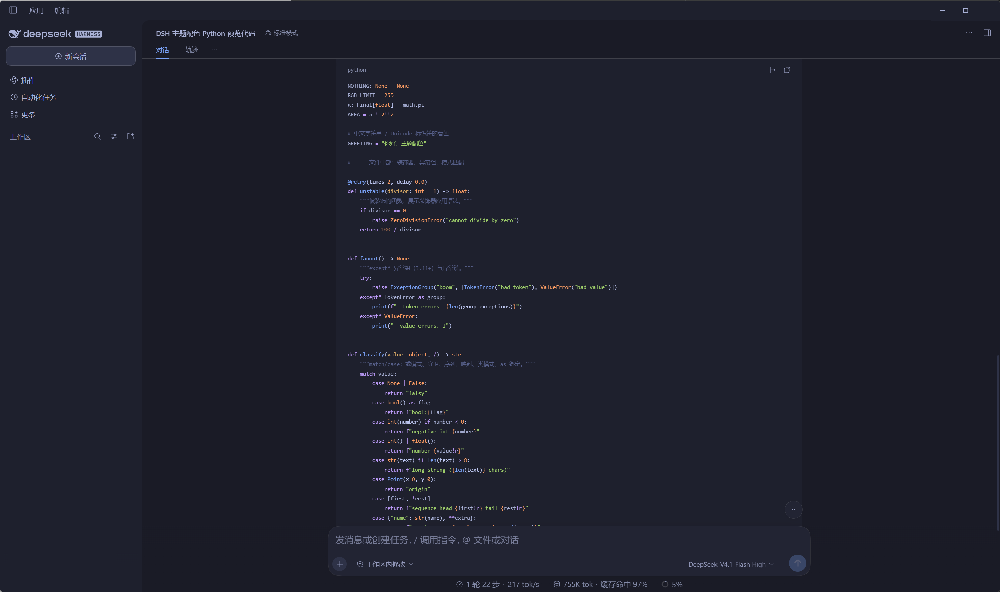
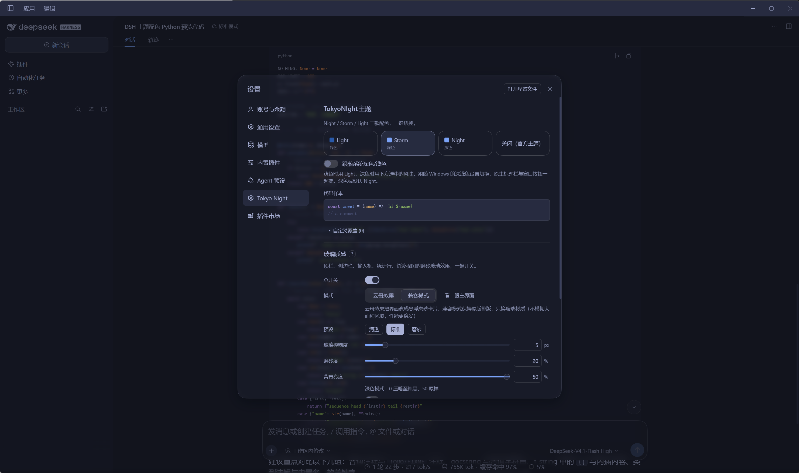
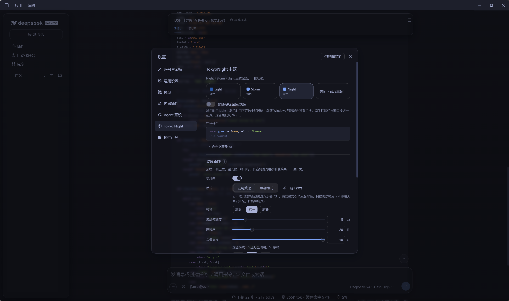

<p align="center">
  
</p>
<h3 align="center">
  Tokyo Night Theme for <a href="https://github.com/deepseek-ai/deepseek-harness">DeepSeek Harness</a>
</h3>

<p align="center">
  <a href="README.md">中文</a> | <strong>English</strong>
</p>

## Introduction

A [Tokyo Night](https://github.com/tokyo-night/tokyo-night-vscode-theme/tree/master) theme plugin for [DeepSeek Harness](https://github.com/deepseek-ai/deepseek-harness), ported from [Catppuccin for DeepSeek Harness](https://github.com/NoNameLeGo/dsh-catppuccin-theme/tree/main).

Includes three UI and syntax-highlighting themes based on [Enkia](https://github.com/tokyo-night/tokyo-night-vscode-theme/commits?author=enkia)'s [Tokyo Night](https://github.com/tokyo-night/tokyo-night-vscode-theme/tree/master) palette: **Tokyo Night Light**, **Tokyo Night**, and **Tokyo Night Storm**.

Also includes an optional, configurable **glassmorphism** skin whose colors automatically follow the selected theme.

Adjust the theme and glass effects on the plugin's dedicated settings page. Your choices are saved automatically and restored on restart.

## Previews

The three themes in DeepSeek Harness, captured from the local GUI:

<details open>
<summary>Tokyo Night Light (light)</summary>



</details>

<details open>
<summary>Tokyo Night Storm (dark)</summary>



</details>

<details open>
<summary>Tokyo Night (dark)</summary>



</details>

### Glass Effects

<details open>
<summary>Glass</summary>



</details>

<details open>
<summary>Mica Glass</summary>



</details>

## Installation

### Option 1: Install from npm (Recommended)

The package has not yet been published to npm. After the first release, use `@beta` for prereleases; omit it once a stable release is available.

**Web**:

```sh
dsh plugin --profile web add dsh-tokyonight-theme@beta
```

Restart `dsh web` after installation. `dsh plugin` automatically adds the package to the profile's bundles.
For another profile, replace `web` with its name, such as `headless`.

**Desktop**:

| Action | Official desktop shell ([DeepSeek Harness](https://github.com/deepseek-ai/deepseek-harness) client) | Community desktop shell ([DSH Desktop](https://github.com/anywhere-labs/dsh-desktop)) |
| --- | --- | --- |
| **Install** | Open the in-app **plugin manager** → Add Plugin → enter `dsh-tokyonight-theme@beta`. Git URLs, archives, and local paths are also accepted. | Run in the **terminal opened by the app**:<br><code>dsh plugin --profile desktop add dsh-tokyonight-theme@beta</code> |
| **Update** | **Remove the plugin in the plugin manager, then reinstall it using the same package name.** | Run in the terminal opened by the app:<br><code>dsh plugin --profile desktop update dsh-tokyonight-theme@beta</code> |
| **pnpm executable** | Bundled with the app | Bundled with the app |

Restart the desktop app after installation or an update to load the plugin.

### Option 2: Install from the Repository

```sh
dsh plugin --profile web add https://github.com/Re50Na/dsh-tokyonight-theme
```

The repository includes prebuilt runtime files in `lib/`. Installation uses these files directly, without running this plugin's build scripts.

For desktop installations, follow the table above: in the **official shell**, enter the Git URL in the plugin manager; in the **community shell**, run the command in the terminal opened by the app and replace `--profile web` with `--profile desktop`.

### [dsh-TUI](https://github.com/ccch1mneyyy/dsh-TUI) Terminal Themes

This section covers the third-party terminal frontend [dsh-TUI](https://github.com/ccch1mneyyy/dsh-TUI), which must be installed separately.
It uses the same package as the Web GUI plugin. Install it into the `dsh-tui` profile with the standard plugin command:

```sh
dsh plugin --profile dsh-tui add dsh-tokyonight-theme@beta
```

Alternatively, install from the repository:

```sh
dsh plugin --profile dsh-tui add https://github.com/Re50Na/dsh-tokyonight-theme
```

The package includes a small component dedicated to syncing themes. When `~/.dsh-tui` already exists, activating this component automatically syncs the three theme JSON files to `~/.dsh-tui/themes/`. Updating the package and restarting also syncs the new colors.

After installation, start `dsh --profile dsh-tui`. In dsh-TUI, use `/theme` to choose **tokyonight-night / tokyonight-storm / tokyonight-light**, or enter `/theme tokyonight-night` to switch directly to Night. Your selection is saved and restored on the next launch.

> 💡 If you have already installed this plugin for the Web GUI and also use dsh-TUI, you do not need to install it again: each Web startup syncs the themes to `~/.dsh-tui/themes/`, provided `~/.dsh-tui` already exists.

> 📁 You can also copy the files manually without installing the package: copy `themes/*.json` to `~/.dsh-tui/themes/` (Windows: `%USERPROFILE%\.dsh-tui\themes\`).

> 💡 TUI themes control colors within the TUI. The terminal background is controlled by your terminal settings, so a matching terminal color scheme is recommended. You can also browse this Tokyo Night wallpaper repository: [wallpapers](https://github.com/tokyo-night/wallpapers).

### Custom Overrides

- The **Custom Overrides** button shows the number of existing entries. In the expandable editor, override individual tokens using `--dsw-* variable: value`, for example `--dsw-static-blue-500` → `#89b4fa`.
- A **key** takes effect when its field loses focus. It must start with `--`; otherwise, the entry is discarded.
- A **value** also takes effect when its field loses focus. **Clearing the value deletes the entry**; click ✕ to remove the entire row.
- Overrides are saved persistently and applied alongside the selected theme.

## 💝 Acknowledgments

- [Catppuccin for DeepSeek Harness](https://github.com/NoNameLeGo/dsh-catppuccin-theme/tree/main): the overall architecture, color mappings, and glass effects implementation.
- [Catppuccin](https://github.com/catppuccin): the palette and port template.
- [DeepSeek Harness](https://github.com/deepseek-ai/deepseek-harness): the plugin system.
- [DSH-Transparent-UI-Plugin](https://github.com/WYH66666666/DSH-Transparent-UI-Plugin): inspiration for glass interactions and implementation, including mica and compatibility modes, as well as blur and frost controls.

## License

MIT. See [LICENSE](LICENSE) and [Third-Party Notices](THIRD_PARTY_NOTICES.md).
