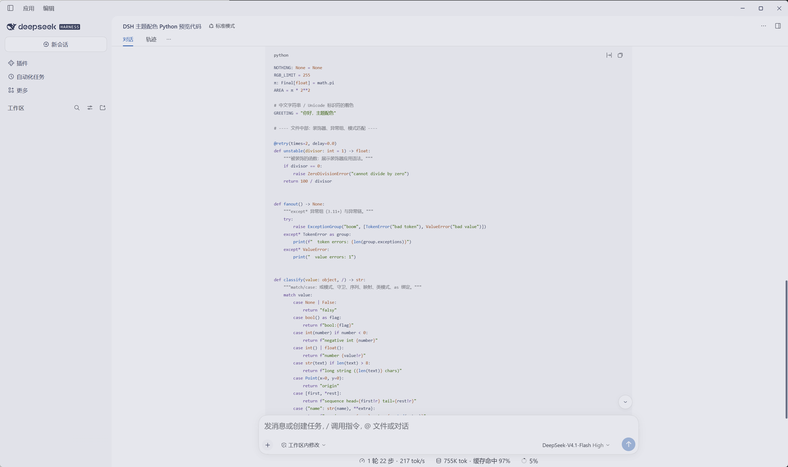
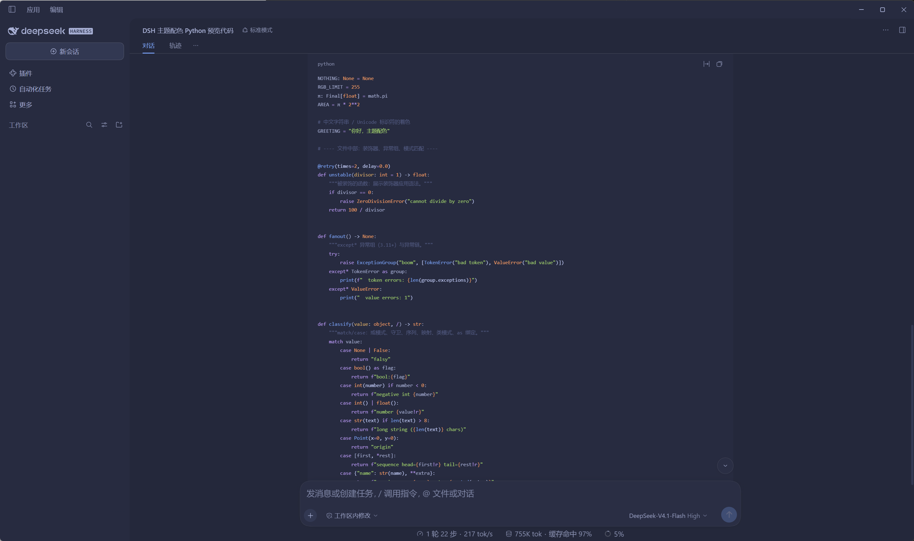
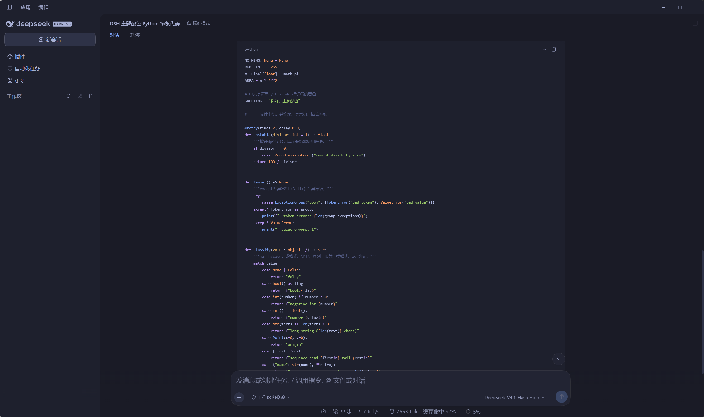
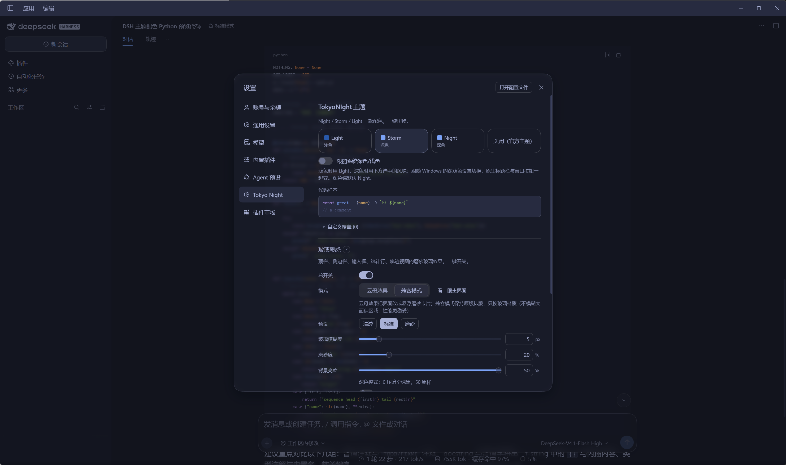
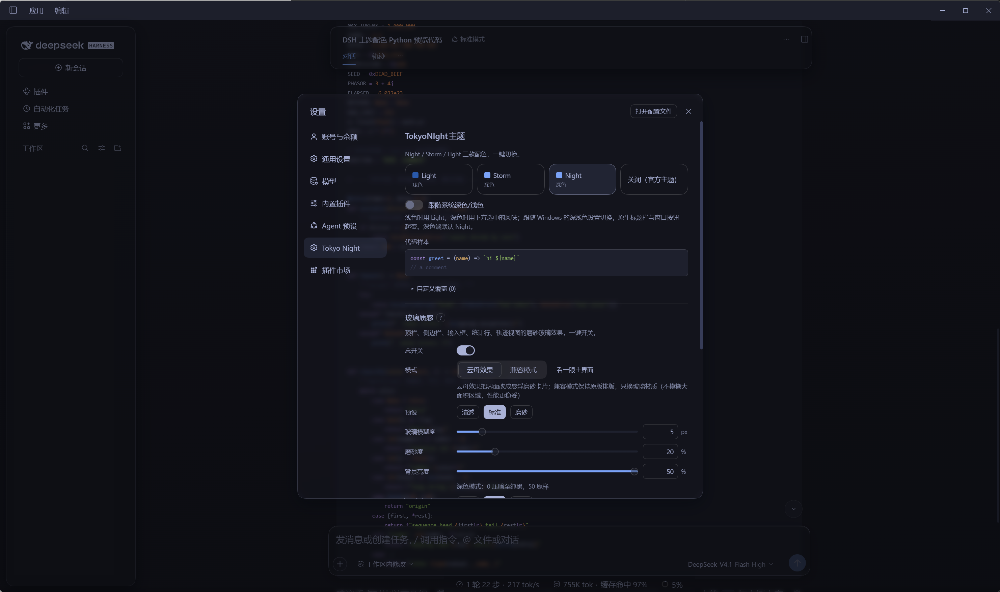

<p align="center">
  
</p>
<h3 align="center">
  Tokyo Night Theme for <a href="https://github.com/deepseek-ai/deepseek-harness">DeepSeek Harness</a>
</h3>

<p align="center">
  <strong>中文</strong> | <a href="README.en.md">English</a>
</p>

## 简介

[DeepSeek Harness](https://github.com/deepseek-ai/deepseek-harness) 的 [Tokyo Night](https://github.com/tokyo-night/tokyo-night-vscode-theme/tree/master) 主题插件，从 [Catppuccin for DeepSeek Harness](https://github.com/NoNameLeGo/dsh-catppuccin-theme/tree/main) 项目移植。

包含以 [Enkia](https://github.com/tokyo-night/tokyo-night-vscode-theme/commits?author=enkia) 的 [Tokyo Night](https://github.com/tokyo-night/tokyo-night-vscode-theme/tree/master) 配色方案为参考的三个 UI 及代码着色主题——**Tokyo Night Light**、**Tokyo Night**、**Tokyo Night Storm**。

同时内置一套可开关和配置的**玻璃质感**（Glassmorphism）皮肤，颜色自动跟随当前设置的主题。

配色及质感可在设置中的独立页面调整，选择会自动保存，重启后自动恢复。

## 预览

三套主题在 DeepSeek Harness 中的实际效果，截图来自本地 GUI：

<details open>
<summary>Tokyo Night Light（浅色）</summary>



</details>

<details open>
<summary>Tokyo Night Storm（深色）</summary>



</details>

<details open>
<summary>Tokyo Night（深色）</summary>



</details>

### 玻璃质感

<details open>
<summary>玻璃</summary>



</details>

<details open>
<summary>云母玻璃</summary>



</details>

## 安装

### 方式一：从 npm 安装（推荐）

当前 npm 包尚未首次发布。发布后，预发布版本使用 `@beta` 安装；正式版发布后可省略 `@beta`。

**Web 端**：

```sh
dsh plugin --profile web add dsh-tokyonight-theme@beta
```

装完重启 `dsh web` 即可，`dsh plugin` 会自动把它加进 profile 的 bundles。
其他 profile 把命令里的 `web` 换成对应名字即可（如 `headless`）。

**桌面版**：

| 操作 | 官方桌面壳（[DeepSeek Harness](https://github.com/deepseek-ai/deepseek-harness) 客户端） | 社区桌面壳（[DSH Desktop](https://github.com/anywhere-labs/dsh-desktop)） |
| --- | --- | --- |
| **安装** | 应用内的**插件界面** → 添加插件 → 填包名 `dsh-tokyonight-theme@beta`（也接受 Git 地址、压缩包或本地路径） | 在应用打开的**终端**里执行：<br><code>dsh plugin --profile desktop add dsh-tokyonight-theme@beta</code> |
| **升级** | **先在插件界面里删除本插件，再填入同一个包名重新安装** | 在应用打开的终端里执行：<br><code>dsh plugin --profile desktop update dsh-tokyonight-theme@beta</code> |
| **谁执行 pnpm** | 应用自带的 pnpm | 应用自带的 pnpm |

安装或升级后，重启桌面应用即可加载。

### 方式二：从仓库安装

```sh
dsh plugin --profile web add https://github.com/Re50Na/dsh-tokyonight-theme
```

仓库已包含预构建的 `lib/` 运行文件，安装时直接使用，无需执行本插件的安装构建脚本。

桌面版同理，但按上面的表操作：**官方壳**在插件界面中直接填 Git 地址；**社区壳**在应用打开的终端里，将命令中的 `--profile web` 换成 `--profile desktop`。

### [dsh-TUI](https://github.com/ccch1mneyyy/dsh-TUI)（终端版）主题

本节针对第三方终端前端 [dsh-TUI](https://github.com/ccch1mneyyy/dsh-TUI)，需先自行安装。
它与 Web GUI 插件使用同一个包，通过标准插件安装命令装进 `dsh-tui` profile：

```sh
dsh plugin --profile dsh-tui add dsh-tokyonight-theme@beta
```

也可以从仓库安装：

```sh
dsh plugin --profile dsh-tui add https://github.com/Re50Na/dsh-tokyonight-theme
```

包中包含一个只负责主题同步的小插件组件。当 `~/.dsh-tui` 已存在时，组件激活会自动把三套主题 JSON 同步到 `~/.dsh-tui/themes/`；升级包并重新启动后，也会同步新版配色。

安装后启动 `dsh --profile dsh-tui`，在 dsh-TUI 中通过 `/theme` 选择 **tokyonight-night / tokyonight-storm / tokyonight-light**，或直接输入 `/theme tokyonight-night` 切换到 Night。选择会持久化，下次启动自动恢复。

> 💡 如果已为 Web GUI 安装本插件，同时也使用 dsh-TUI，无需重复安装：Web 端每次启动会自动同步主题到 `~/.dsh-tui/themes/`（仅当 `~/.dsh-tui` 已存在时）。

> 📁 不想安装包也可手动复制：将 `themes/*.json` 拷贝到 `~/.dsh-tui/themes/`（Windows：`%USERPROFILE%\.dsh-tui\themes\`）。

> 💡 TUI 主题只控制 TUI 内部配色，终端背景由终端配置决定，建议搭配相应的终端配色。也可以参考这个 Tokyo Night 壁纸仓库：[wallpapers](https://github.com/tokyo-night/wallpapers)。

### 自定义覆盖

- **自定义覆盖**折叠区的按钮会显示已有条数。按「`--dsw-* 变量: 值`」逐条覆盖单个 token，例如 `--dsw-static-blue-500` → `#89b4fa`。
- **键名**失焦时生效，且必须以 `--` 开头，否则该条会被丢弃。
- **值**同样在失焦时生效，**清空值即删除该条**；点击 ✕ 可删除整行。
- 覆盖会持久保存，并与所选主题一起生效。

## 💝 致谢

- [Catppuccin for DeepSeek Harness](https://github.com/NoNameLeGo/dsh-catppuccin-theme/tree/main)：提供整体架构、配色映射和玻璃质感实现。
- [Catppuccin](https://github.com/catppuccin)：提供色板与移植模板。
- [DeepSeek Harness](https://github.com/deepseek-ai/deepseek-harness)：提供插件体系。
- [DSH-Transparent-UI-Plugin](https://github.com/WYH66666666/DSH-Transparent-UI-Plugin)：玻璃质感交互与实现参考，包括云母 / 兼容双模式，以及模糊度、磨砂度等旋钮设计。

## 许可

MIT。详见 [LICENSE](LICENSE) 和 [第三方声明](THIRD_PARTY_NOTICES.md)。
